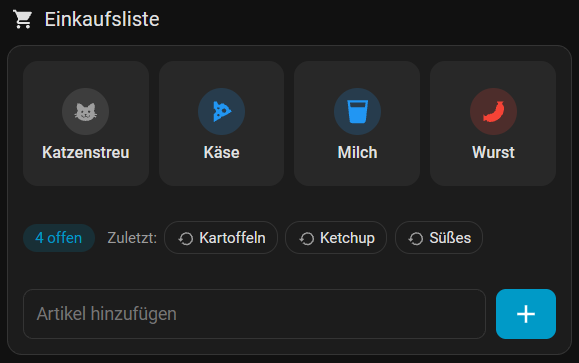
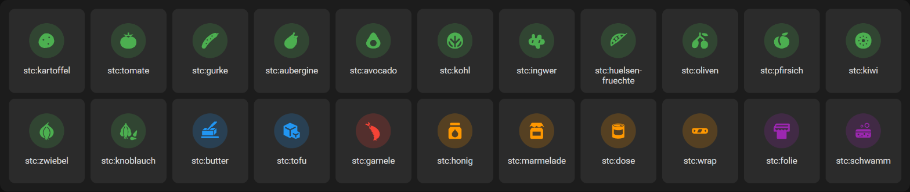

# Shopping Tiles Card

Eine kleine Dashboard-Karte für Home Assistant, die die offenen Artikel einer To-do-Liste als Kacheln mit Symbol zeigt – etwas grafischer als die Standard-Liste, näher an dem, wie Einkaufslisten-Apps aussehen. Mit Favoriten, Sortierung nach dem Weg durch den Laden und 22 eigenen Symbolen für Artikel, für die es in der eingebauten Symbolsammlung nichts gibt.

Entstanden ist sie als privates Projekt, um einer Bring!-Einkaufsliste in Home Assistant einen freundlicheren Auftritt zu geben – nur mit den Bordmitteln von Home Assistant.

[](https://my.home-assistant.io/redirect/hacs_repository/?owner=plerzelwupp&repository=shopping-tiles-card&category=plugin)

*English description: [README.md](README.md)*



## Was sie kann

### Darstellung
- **Offene Artikel als Kacheln** – Symbol, Name und die Angabe zum Artikel (z. B. „1 kg, Bio“) darunter.
- **Symbole werden automatisch gewählt**, anhand des Artikelnamens. Rund 230 deutsche und 175 englische Stichworte führen auf 90 Symbole: 68 aus der in Home Assistant eingebauten Symbolsammlung (Material Design Icons) und 22 eigene für häufige Artikel, für die es dort nichts gibt (Kartoffeln, Tomaten, Zwiebeln, Knoblauch, Butter, Honig, Marmelade, …). Artikel ohne Treffer bekommen einen Einkaufskorb. Eigene Zuordnungen lassen sich ergänzen.
- **Farben nach Bereich** – Obst & Gemüse, Backwaren & Vorrat, Fleisch & Fisch, Kühlregal & Tiefkühl, Süßes & Snacks, Getränke, Drogerie & Haushalt. Die Farben kommen aus dem Home-Assistant-Design, helles und dunkles Design funktionieren beide.
- **Eigener Symbolsatz `stc:`** – die 22 eigenen Symbole werden beim Laden der Karte als Symbolsatz angemeldet und lassen sich so auch in anderen Karten nutzen (z. B. `icon: stc:kartoffel`). Eigene Entwürfe, MIT-Lizenz wie die Karte.

  

### Bedienung
- **Antippen hakt ab**, mit kurzem „Rückgängig“ – auch für mehrere schnell abgehakte Artikel auf einmal.
- **Lange drücken (oder Rechtsklick) zum Bearbeiten** – Name oder Angabe ändern, Artikel löschen (auch das Löschen lässt sich rückgängig machen) oder zu den Favoriten hinzufügen.
- **Artikel hinzufügen** direkt in der Karte.
- **Mit Tastatur bedienbar** – Tab springt von Kachel zu Kachel (auch im Fenster mit allen Artikeln), Enter oder Leertaste hakt ab, F2 oder die Kontextmenü-Taste öffnet „Bearbeiten“. Kacheln und Fenster haben Beschriftungen für Screenreader (bisher nicht mit einem Screenreader getestet).

### Einkaufshilfen
- **Sortierung** – offene Artikel wie von der Liste geliefert, alphabetisch oder nach Bereich gruppiert, in der Reihenfolge eines typischen Wegs durch den Laden (Obst & Gemüse zuerst, Drogerie & Haushalt zuletzt).
- **Favoriten** – eine eigene Liste mit oft gekauften Artikeln (z. B. Milch, Brot, Eier), als Kacheln mit kleinem ★; ein Tipp setzt den Artikel auf die Liste. Steht er unter „Zuletzt gekauft“, wird genau dieser Eintrag wieder aktiviert (kein doppelter Eintrag in Bring!), sonst neu angelegt. Favoriten, die schon auf der Liste stehen, werden ausgeblendet.  
  **Favoriten-Liste (empfohlen):** Im grafischen Editor legt *Favoriten-Liste anlegen* in Home Assistant eine To-do-Liste „Favoriten“ an (eingebaute Integration Local To-do, nur für Administratoren) und wählt sie aus – oder man wählt eine vorhandene To-do-Liste, auch eine zweite Bring!-Liste. Dann bietet langes Drücken auf einen Artikel **☆ Zu Favoriten hinzufügen**, langes Drücken auf einen Favoriten **Aus Favoriten entfernen**. Die Liste gilt für alle Karten und lässt sich in Home Assistant auch unter *To-do-Listen* bearbeiten. Bereits im Textfeld eingetragene Favoriten lassen sich mit einem Klick übernehmen. Ohne Favoriten-Liste funktioniert das Textfeld `favorites` wie bisher; es steht dann pro Karte in der Kartenkonfiguration, nicht in Bring!.
- **Zuletzt gekauft** – kürzlich abgehakte Artikel erscheinen als kleine Einträge; ein Tipp setzt sie wieder auf die Liste. Bei einer hohen Karte werden daraus Kacheln (mit kleinem ↺ markiert).
- **„+N weitere“** – passt nicht alles hinein, öffnet die letzte Kachel ein Fenster mit allen offenen Artikeln, den Favoriten und den zuletzt gekauften Artikeln.

### Technik
- **Passt ins Sections-Raster und in Vollbild-Ansichten** – alle Kacheln sind gleich groß; die Zahl der Kachelreihen richtet sich nach der Kartenhöhe. Freie Reihen gehen zuerst an die Favoriten, dann an „Zuletzt gekauft“ – praktisch auf einem Wandbildschirm.
- **Grafischer Editor** und Texte auf Deutsch/Englisch (richtet sich nach der Home-Assistant-Sprache).
- **Robust** – ist die Liste kurz nicht verfügbar (z. B. während die Bring!-Integration neu lädt), zeigt die Karte eine Meldung statt veralteter Artikel und verbindet sich von selbst neu.
- **Keine Abhängigkeiten** – eine einzige JavaScript-Datei, kein Mushroom, button-card oder card-mod nötig.

| Fenster mit allen Artikeln | Artikel bearbeiten |
|---|---|
|  |  |

## Funktioniert mit

Jeder To-do-Liste in Home Assistant (`todo.*`) – zum Beispiel der **Bring!**-Integration, der eingebauten **Einkaufsliste** oder **Local To-do**.
Die Angabe bearbeiten geht nur, wenn die Liste Beschreibungen unterstützt (Bring! kann das).

**Mit Bring! nutzen:** die eingebaute Bring!-Integration hinzufügen (*Einstellungen → Geräte & Dienste → Integration hinzufügen → Bring!*). Jede Bring!-Liste wird zu einer `todo.*`-Entität, die man in der Karte auswählt. Wer sich bei Bring! nur mit Google oder Apple anmeldet, muss im Bring!-Konto zuerst ein Passwort vergeben. Änderungen in Home Assistant erscheinen sofort in der Bring!-App; Änderungen in der App können bis zu etwa 90 Sekunden brauchen, bis sie in Home Assistant ankommen (Abfrageintervall der Integration).

## Installation

**Marketplace / HACS (eigenes Repository)**
Am einfachsten über den Knopf oben auf dieser Seite. Oder von Hand:
1. Dieses Repository als eigenes Repository hinzufügen, Typ *Dashboard* (im Marketplace über den Link hinzufügen – dafür muss im Marketplace ein GitHub-Konto verbunden sein; bei HACS unter *Benutzerdefinierte Repositories*).
2. *Shopping Tiles Card* installieren und den Browser neu laden.

**Manuell**
1. `shopping-tiles-card.js` nach `/config/www/` kopieren.
2. *Einstellungen → Dashboards → ⋮ → Ressourcen → Ressource hinzufügen*: URL `/local/shopping-tiles-card.js`, Typ *JavaScript-Modul*.
3. Browser neu laden.

## Einstellungen

Karte über *Karte hinzufügen → Shopping Tiles Card* einfügen und im grafischen Editor einstellen, oder in YAML:

```yaml
type: custom:shopping-tiles-card
entity: todo.einkaufsliste
```

| Option | Bedeutung | Standard |
|---|---|---|
| `entity` | Die To-do-Liste | – (Pflicht) |
| `rows` | Anzahl Kachelreihen (1–5). Weglassen = automatisch passend zur Kartenhöhe. | automatisch |
| `show_recent` | Zuletzt gekaufte Artikel anzeigen | `true` |
| `recent_style` | Darstellung der zuletzt gekauften Artikel: `auto` (Kacheln, wenn nach allen offenen Artikeln Reihen frei sind, sonst kleine Einträge), `tiles` (immer mindestens eine Reihe Kacheln, wenn die Karte hoch genug ist) oder `chips` | `auto` |
| `sort` | Reihenfolge der offenen Artikel: `none` (wie von der Liste geliefert), `category` (nach Bereich gruppiert, in der Reihenfolge eines typischen Einkaufs: Obst & Gemüse, Backwaren & Vorrat, Fleisch & Fisch, Kühlregal & Tiefkühl, Süßes & Snacks, Getränke, Drogerie & Haushalt) oder `alpha` (alphabetisch) | `none` |
| `favorites_entity` | To-do-Liste mit den Favoriten (z. B. `todo.favoriten`); gilt für alle Karten, Artikel lassen sich per langem Drücken hinzufügen. Hat Vorrang vor `favorites` | – |
| `favorites` | Favoriten, durch Komma getrennt (z. B. `Milch, Brot, Eier`) oder als YAML-Liste (nur ohne `favorites_entity`) | – |
| `favorites_in_recent` | Abgehakte Favoriten zusätzlich unter „Zuletzt gekauft“ zeigen (standardmäßig erscheinen sie nur bei den Favoriten, damit nichts doppelt steht) | `false` |
| `show_title` | Titel in der Karte anzeigen | `true` |
| `title` | Titeltext | „Einkaufsliste“ |
| `language` | `de` oder `en` (Standard: Sprache von Home Assistant, sonst Englisch) | automatisch |
| `icons` | Eigene Zuordnung Stichwort → Symbol (nur YAML) | – |

Beispiel mit eigenen Symbolen (das Stichwort darf irgendwo im Artikelnamen stehen, Groß-/Kleinschreibung egal):

```yaml
type: custom:shopping-tiles-card
entity: todo.einkaufsliste
icons:
  sellerie: mdi:sprout
  brühe: stc:dose
```

## Gut zu wissen

- Das Bearbeiten-Fenster bietet nur an, was die Liste kann: Die Angabe erscheint nur bei Listen mit Beschreibungen (z. B. Bring!, Local To-do, nicht die eingebaute Einkaufsliste). Klappt das Speichern nicht, bleibt das Fenster offen und zeigt den Fehler.
- Grenzen der Anzeige: „Zuletzt gekauft“ zeigt als kleine Einträge bis zu 10 Artikel, im Fenster „Alle anzeigen“ bis zu 24. Favoriten haben keine Obergrenze; wie viele als Kacheln erscheinen, richtet sich nach dem Platz, alle stehen im Fenster „Alle anzeigen“.
- Einige Artikel bekommen weiterhin den Einkaufskorb (z. B. Sellerie, Radieschen, Brühe) – dafür lässt sich eine eigene Zuordnung anlegen, auch auf eines der `stc:`-Symbole.
- „Zuletzt gekauft“ nutzt die Reihenfolge, in der die Liste erledigte Artikel liefert. Bring! liefert keinen Zeitpunkt mit, die Reihenfolge ist also nur ungefähr.
- Getestet mit Home Assistant 2026.11 in Chrome unter Windows und auf einem Android-Handy (helles und dunkles Design), mit der Bring!-Integration, Local To-do und der eingebauten Einkaufsliste. Ältere Versionen funktionieren eventuell, sind aber nicht getestet. Laut Rückmeldung aus der Community sieht die Karte auch auf dem iPhone gut aus.
- Lässt sich die Liste nicht lesen oder ist sie nicht verfügbar (z. B. weil die Entität entfernt wurde oder die Integration gerade neu lädt), zeigt die Karte nur eine Meldung statt veralteter Artikel. Sobald die Liste wieder da ist, verbindet sie sich von selbst neu; nach einem Lesefehler versucht sie es alle 30 Sekunden erneut.
- Das ist ein Hobbyprojekt. Rückmeldungen und Fehlerberichte sind willkommen.

## Unterstützen

Wenn Dir die Karte gefällt und Du Danke sagen möchtest, kannst Du mir einen Kaffee spendieren – ganz freiwillig, über Rückmeldungen freue ich mich genauso.

[](https://paypal.me/plerzelwupp)

## Hinweis

Dieses Projekt steht in keiner Verbindung zur Bring! Labs AG und wird von ihr weder unterstützt noch empfohlen. „Bring!“ ist eine Marke des jeweiligen Inhabers. Es werden keine Bring!-Grafiken verwendet – die Symbole stammen aus der in Home Assistant enthaltenen Sammlung Material Design Icons, dazu 22 eigens für diese Karte gezeichnete.

## Lizenz

[MIT](LICENSE) © 2026 plerzelwupp
