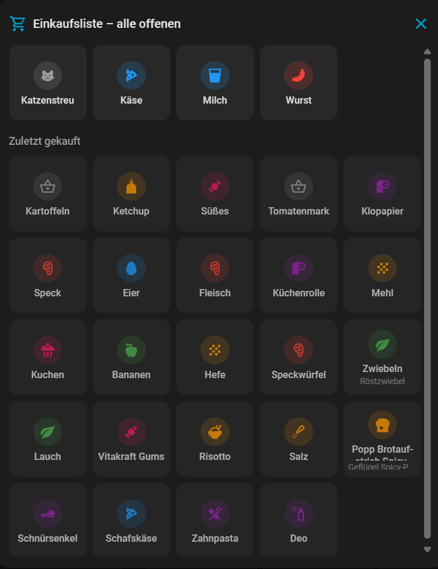
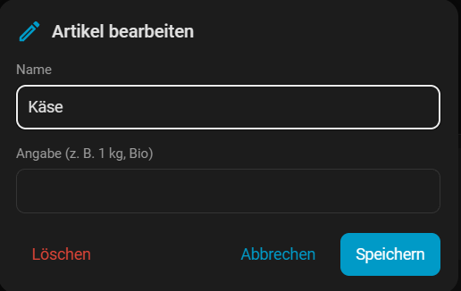

# Shopping Tiles Card

Eine kleine Dashboard-Karte für Home Assistant, die die offenen Artikel einer To-do-Liste als Kacheln mit Symbol zeigt – etwas grafischer als die Standard-Liste, näher an dem, wie Einkaufslisten-Apps aussehen.

Entstanden ist sie als privates Projekt, um einer Bring!-Einkaufsliste in Home Assistant einen freundlicheren Auftritt zu geben – nur mit den Bordmitteln von Home Assistant.

[](https://my.home-assistant.io/redirect/hacs_repository/?owner=plerzelwupp&repository=shopping-tiles-card&category=plugin)

*English description: [README.md](README.md)*


## Was sie kann

- **Offene Artikel als Kacheln** – Symbol, Name und die Angabe zum Artikel (z. B. „1 kg, Bio“) in einer Zeile darunter.
- **Symbole werden automatisch gewählt**, anhand des Artikelnamens. Rund 140 deutsche und 140 englische Stichworte führen auf 61 Symbole aus der in Home Assistant eingebauten Symbolsammlung (Material Design Icons). Artikel ohne Treffer bekommen einen Einkaufskorb. Eigene Zuordnungen lassen sich ergänzen.
- **Farben nach Bereich** – Obst & Gemüse, Kühlregal, Fleisch & Fisch, Backwaren & Vorrat, Drogerie & Haushalt, Getränke, Süßes & Snacks. Die Farben kommen aus dem Home-Assistant-Design, helles und dunkles Design funktionieren beide.
- **Antippen hakt ab**, mit kurzem „Rückgängig“ – auch für mehrere schnell abgehakte Artikel auf einmal.
- **Lange drücken (oder Rechtsklick) zum Bearbeiten** – Name oder Angabe ändern, Artikel löschen (auch das Löschen lässt sich rückgängig machen).
- **Mit Tastatur bedienbar** – Tab springt von Kachel zu Kachel (auch im Fenster mit allen Artikeln), Enter oder Leertaste hakt ab, F2 oder die Kontextmenü-Taste öffnet „Bearbeiten“. Die Kacheln haben Beschriftungen für Screenreader (bisher nicht mit einem Screenreader getestet).
- **Zuletzt gekauft** – kürzlich abgehakte Artikel erscheinen als kleine Einträge; ein Tipp setzt sie wieder auf die Liste. Bei einer hohen Karte (z. B. auf einem Wandbildschirm oder in einer Vollbild-Ansicht) werden freie Reihen stattdessen mit Kacheln der zuletzt gekauften Artikel gefüllt (mit kleinem ↺ markiert).
- **„+N weitere“** – passt nicht alles hinein, öffnet die letzte Kachel ein Fenster mit allen offenen und den zuletzt gekauften Artikeln.
- **Passt ins Sections-Raster** – alle Kacheln sind gleich groß; die Zahl der Kachelreihen richtet sich nach der Kartenhöhe.
- **Artikel hinzufügen** direkt in der Karte.
- **Grafischer Editor** und Texte auf Deutsch/Englisch (richtet sich nach der Home-Assistant-Sprache).
- **Keine Abhängigkeiten** – eine einzige JavaScript-Datei, kein Mushroom, button-card oder card-mod nötig.

| Fenster mit allen Artikeln | Artikel bearbeiten |
|---|---|
|  |  |

## Funktioniert mit

Jeder To-do-Liste in Home Assistant (`todo.*`) – zum Beispiel der **Bring!**-Integration, der eingebauten **Einkaufsliste** oder **Local To-do**.
Die Angabe bearbeiten geht nur, wenn die Liste Beschreibungen unterstützt (Bring! kann das).

**Mit Bring! nutzen:** die eingebaute Bring!-Integration hinzufügen (*Einstellungen → Geräte & Dienste → Integration hinzufügen → Bring!*). Jede Bring!-Liste wird zu einer `todo.*`-Entität, die man in der Karte auswählt. Wer sich bei Bring! nur mit Google oder Apple anmeldet, muss im Bring!-Konto zuerst ein Passwort vergeben. Änderungen in Home Assistant erscheinen sofort in der Bring!-App; Änderungen in der App können bis zu etwa 90 Sekunden brauchen, bis sie in Home Assistant ankommen (Abfrageintervall der Integration).

## Installation

**Marketplace / HACS (eigenes Repository)**
Am einfachsten über den Knopf oben auf dieser Seite. Oder von Hand:
1. Dieses Repository als eigenes Repository hinzufügen, Typ *Dashboard* (im Marketplace über den Link hinzufügen – dafür muss im Marketplace ein GitHub-Konto verbunden sein; bei HACS unter *Benutzerdefinierte Repositories*).
2. *Shopping Tiles Card* installieren und den Browser neu laden.

**Manuell**
1. `shopping-tiles-card.js` nach `/config/www/` kopieren.
2. *Einstellungen → Dashboards → ⋮ → Ressourcen → Ressource hinzufügen*: URL `/local/shopping-tiles-card.js`, Typ *JavaScript-Modul*.
3. Browser neu laden.

## Einstellungen

Karte über *Karte hinzufügen → Shopping Tiles Card* einfügen und im grafischen Editor einstellen, oder in YAML:

```yaml
type: custom:shopping-tiles-card
entity: todo.einkaufsliste
```

| Option | Bedeutung | Standard |
|---|---|---|
| `entity` | Die To-do-Liste | – (Pflicht) |
| `rows` | Anzahl Kachelreihen (1–5). Weglassen = automatisch passend zur Kartenhöhe. | automatisch |
| `show_recent` | Zuletzt gekaufte Artikel anzeigen | `true` |
| `recent_style` | Darstellung der zuletzt gekauften Artikel: `auto` (Kacheln, wenn nach allen offenen Artikeln Reihen frei sind, sonst kleine Einträge), `tiles` (immer mindestens eine Reihe Kacheln, wenn die Karte hoch genug ist) oder `chips` | `auto` |
| `show_title` | Titel in der Karte anzeigen | `true` |
| `title` | Titeltext | „Einkaufsliste“ |
| `language` | `de` oder `en` (Standard: Sprache von Home Assistant, sonst Englisch) | automatisch |
| `icons` | Eigene Zuordnung Stichwort → Symbol (nur YAML) | – |

Beispiel mit eigenen Symbolen (das Stichwort darf irgendwo im Artikelnamen stehen, Groß-/Kleinschreibung egal):

```yaml
type: custom:shopping-tiles-card
entity: todo.einkaufsliste
icons:
  kartoffel: mdi:sprout
  tomate: mdi:fruit-cherries
```

## Gut zu wissen

- Für einige häufige Artikel gibt es in der Symbolsammlung kein passendes Symbol (Kartoffeln, Tomaten, Butter, Honig, Marmelade, …) – sie bekommen den Einkaufskorb, sofern man keine eigene Zuordnung anlegt.
- „Zuletzt gekauft“ nutzt die Reihenfolge, in der die Liste erledigte Artikel liefert. Bring! liefert keinen Zeitpunkt mit, die Reihenfolge ist also nur ungefähr.
- Getestet mit Home Assistant 2026.11 in Chrome unter Windows und auf einem Android-Handy (helles und dunkles Design), mit der Bring!-Integration, Local To-do und der eingebauten Einkaufsliste. Ältere Versionen funktionieren eventuell, sind aber nicht getestet. Laut Rückmeldung aus der Community sieht die Karte auch auf dem iPhone gut aus.
- Lässt sich die Liste nicht lesen (z. B. weil die Entität entfernt wurde), zeigt die Karte den Fehler und versucht es alle 30 Sekunden erneut.
- Das ist ein Hobbyprojekt. Rückmeldungen und Fehlerberichte sind willkommen.

## Unterstützen

Wenn Dir die Karte gefällt und Du Danke sagen möchtest, kannst Du mir einen Kaffee spendieren – ganz freiwillig, über Rückmeldungen freue ich mich genauso.

[](https://paypal.me/plerzelwupp)

## Hinweis

Dieses Projekt steht in keiner Verbindung zur Bring! Labs AG und wird von ihr weder unterstützt noch empfohlen. „Bring!“ ist eine Marke des jeweiligen Inhabers. Es werden keine Bring!-Grafiken verwendet – alle Symbole stammen aus der in Home Assistant enthaltenen Sammlung Material Design Icons.

## Lizenz

[MIT](LICENSE) © 2026 plerzelwupp
