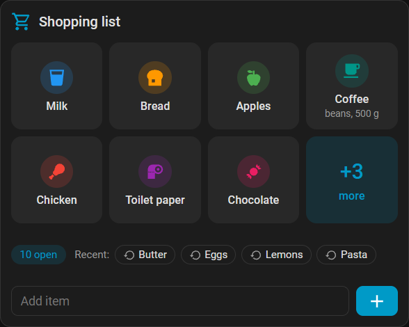
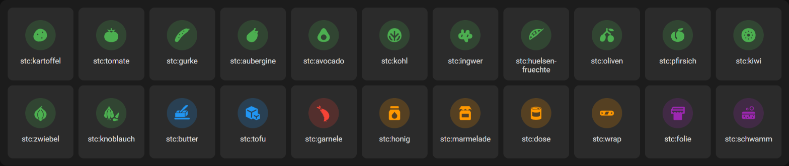
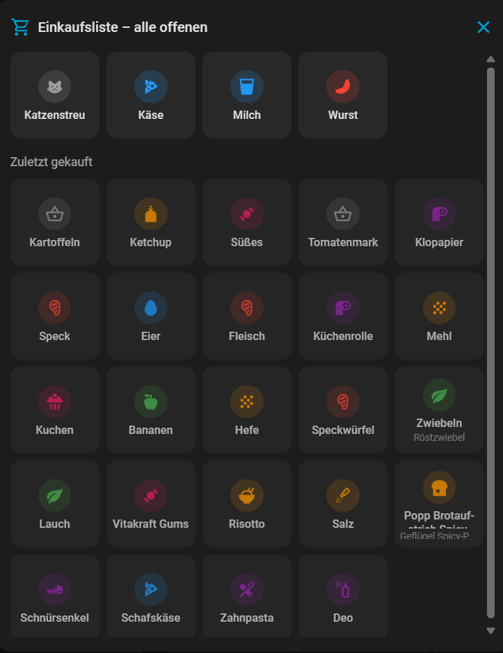
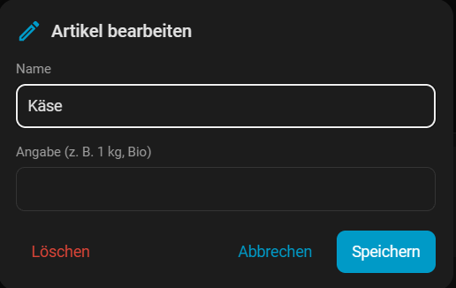

# Shopping Tiles Card

A small Home Assistant dashboard card that shows the open items of a to-do list as tiles with an icon — a bit more visual than the standard list, closer to what shopping-list apps look like. With favorites, sorting by the route through the shop and 22 own icons for items the built-in icon set has nothing for.

It started as a personal project to give a Bring! shopping list in Home Assistant a friendlier look, using only Home Assistant's own building blocks.

[](https://my.home-assistant.io/redirect/hacs_repository/?owner=plerzelwupp&repository=shopping-tiles-card&category=plugin)

*Deutsche Beschreibung: [README.de.md](README.de.md)*



## What it does

### Display
- **Open items as tiles** – icon, name and the item's details (e.g. "1 kg, organic") below.
- **Icons are picked automatically** from the item name. About 230 German and 175 English keywords map to 90 icons: 68 from Home Assistant's built-in icon set (Material Design Icons) and 22 own icons for common items the built-in set has nothing for (potatoes, tomatoes, onions, garlic, butter, honey, jam, …). Items without a match get a basket icon. You can add your own mappings.
- **Colours by category** – fruit & vegetables, bakery & pantry, meat & fish, dairy & frozen, sweets & snacks, drinks, household. The colours come from your Home Assistant theme, so light and dark mode both work.
- **Own icon set `stc:`** – the 22 own icons are registered as an icon set while the card is loaded, so you can use them in other cards too (e.g. `icon: stc:kartoffel`). Original designs, MIT licensed like the card.

  

### Using it
- **Tap to check off**, with a short "Undo" – it also covers several quick check-offs at once.
- **Long press (or right-click) to edit** – rename, change the details, delete an item (deleting can be undone too) or add it to the favorites.
- **Add items** directly in the card.
- **Keyboard support** – Tab moves between tiles (also in the "all items" dialog), Enter or Space checks off, F2 or the context menu key opens "Edit". Tiles and dialogs carry labels for screen readers (not yet tested with a screen reader).

### Shopping helpers
- **Sorting** – open items as delivered by the list, alphabetically, or grouped by category in the order of a typical walk through the shop (fruit & vegetables first, household last).
- **Favorites** – your own list of items you buy often (e.g. milk, bread, eggs), shown as tiles marked with a small ★; one tap puts the item on the list. If it is under "recently bought", exactly that entry is reactivated (no duplicate in Bring!), otherwise it is added. Favorites already on the list are hidden.  
  **Favorites list (recommended):** in the visual editor, *Create favorites list* sets up a to-do list “Favorites” in Home Assistant (built-in Local To-do integration, admins only) and selects it – or pick any existing to-do list, even a second Bring! list. Then a long press on an item offers **☆ Add to favorites**, and a long press on a favorite **Remove from favorites**. The list is shared by all cards and can also be edited under *To-do lists* in Home Assistant. Favorites entered in the text field can be moved into the list with one click. Without a favorites list, the text field `favorites` works as before; it is stored per card in the card configuration, not in Bring!.
- **Recently bought** – recently checked-off items appear as small chips; one tap puts them back on the list. On a tall card they become tiles (marked with a small ↺).
- **"+N more"** – if not everything fits, the last tile opens a pop-up with all open items, the favorites and the recently bought ones.

### Under the hood
- **Fits the sections grid and full-screen panel views** – all tiles have the same size; the number of tile rows follows the card's height. Free rows go to favorites first, then to recently bought items – handy on a wall display.
- **Visual editor** and German/English texts (follows the Home Assistant language).
- **Robust** – if the list is unavailable for a moment (e.g. while the Bring! integration reloads), the card shows a message instead of outdated items and reconnects by itself.
- **No dependencies** – one JavaScript file, no Mushroom, button-card or card-mod needed.

| Pop-up with all items | Edit an item |
|---|---|
|  |  |

## Works with

Any Home Assistant to-do list (`todo.*`) – for example the **Bring!** integration, the built-in **Shopping List** or **Local To-do**.
Editing the details only works if the list supports descriptions (Bring! does).

**Using it with Bring!:** add the built-in Bring! integration (*Settings → Devices & services → Add integration → Bring!*). Each Bring! list becomes a `todo.*` entity you can pick in the card. If you sign in to Bring! with Google or Apple, you first need to set a password in your Bring! account. Changes made in Home Assistant appear in the Bring! app right away; changes made in the app can take up to about 90 seconds to show up in Home Assistant (polling interval of the integration).

## Installation

**Marketplace / HACS (custom repository)**
Easiest: use the button at the top of this page. Or manually:
1. Add this repository as a custom repository, type *Dashboard* (Marketplace: *Add from link* – this needs a GitHub account connected in the Marketplace; HACS: *Custom repositories*).
2. Install *Shopping Tiles Card* and reload the browser.

**Manual**
1. Copy `shopping-tiles-card.js` to `/config/www/`.
2. *Settings → Dashboards → ⋮ → Resources → Add resource*: URL `/local/shopping-tiles-card.js`, type *JavaScript module*.
3. Reload the browser.

## Configuration

Add the card via *Add card → Shopping Tiles Card* and use the visual editor, or in YAML:

```yaml
type: custom:shopping-tiles-card
entity: todo.shopping_list
```

| Option | Description | Default |
|---|---|---|
| `entity` | The to-do list | – (required) |
| `rows` | Number of tile rows (1–5). Leave out for automatic (fits the card height). | automatic |
| `show_recent` | Show recently bought items | `true` |
| `recent_style` | How to show recently bought items: `auto` (tiles if rows are left after all open items, otherwise chips), `tiles` (always at least one row of tiles, if the card is tall enough) or `chips` | `auto` |
| `sort` | Order of the open items: `none` (as delivered by the list), `category` (grouped by area, in the order of a typical walk through the shop: fruit & vegetables, bakery & pantry, meat & fish, dairy & frozen, sweets & snacks, drinks, household) or `alpha` (alphabetical) | `none` |
| `favorites_entity` | A to-do list holding the favorites (e.g. `todo.favorites`); shared by all cards, items can be added with a long press. Takes precedence over `favorites` | – |
| `favorites` | Favorite items, comma-separated (e.g. `milk, bread, eggs`) or as a YAML list (only used without `favorites_entity`) | – |
| `favorites_in_recent` | Also show checked-off favorites under "recently bought" (by default they only appear as favorites, so nothing is shown twice) | `false` |
| `show_title` | Show a title inside the card | `true` |
| `title` | Title text | "Shopping list" |
| `language` | `de` or `en` (default: Home Assistant language, otherwise English) | automatic |
| `icons` | Your own keyword → icon mapping (YAML only) | – |

Example with your own icons (keywords are matched anywhere in the item name, case-insensitive):

```yaml
type: custom:shopping-tiles-card
entity: todo.shopping_list
icons:
  celery: mdi:sprout
  stock: stc:dose
```

## Good to know

- The edit dialog only offers what the list supports: the details field appears only for lists with descriptions (e.g. Bring!, Local To-do, not the built-in Shopping List). If saving fails, the dialog stays open and shows the error.
- Display limits: "recently bought" shows up to 10 items as chips and up to 24 in the "all items" pop-up. Favorites have no limit; how many appear as tiles depends on the space, all of them are in the "all items" pop-up.
- A few items still get the basket (e.g. celery, radishes, stock) – you can add your own mapping, also to one of the `stc:` icons.
- "Recently bought" uses the order in which the list provides completed items. Bring! does not provide a timestamp, so the order is only approximate.
- Tested with Home Assistant 2026.11 in Chrome on Windows and on an Android phone (light and dark theme), with the Bring! integration, Local To-do and the built-in Shopping List. Older versions may work but have not been tested. Community feedback: also looks good on an iPhone.
- If the list cannot be read or is not available (e.g. the entity was removed or the integration is being reloaded), the card shows only a message instead of outdated items. As soon as the list is back, it reconnects by itself; after a read error it tries again every 30 seconds.
- This is a hobby project. Feedback and issues are welcome.

## Support

If the card is useful to you and you'd like to say thanks, you can buy me a coffee – completely optional, feedback is just as welcome.

[](https://paypal.me/plerzelwupp)

## Disclaimer

This project is not affiliated with, endorsed by or connected to Bring! Labs AG. "Bring!" is a trademark of its respective owner. No Bring! artwork is used – the icons come from the Material Design Icons set included in Home Assistant, plus 22 icons designed for this card.

## License

[MIT](LICENSE) © 2026 plerzelwupp
